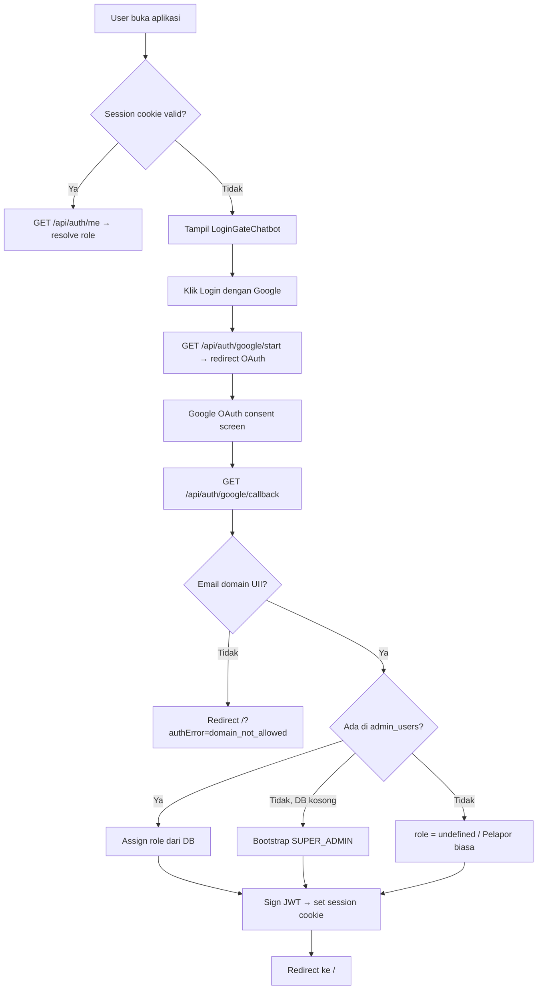
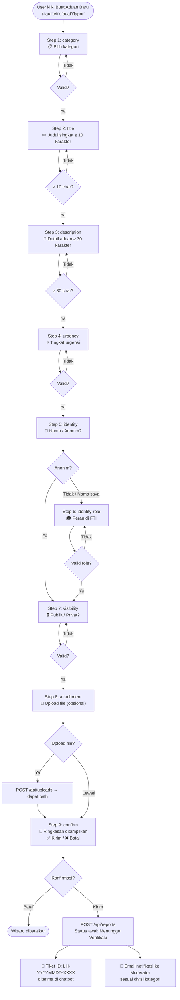
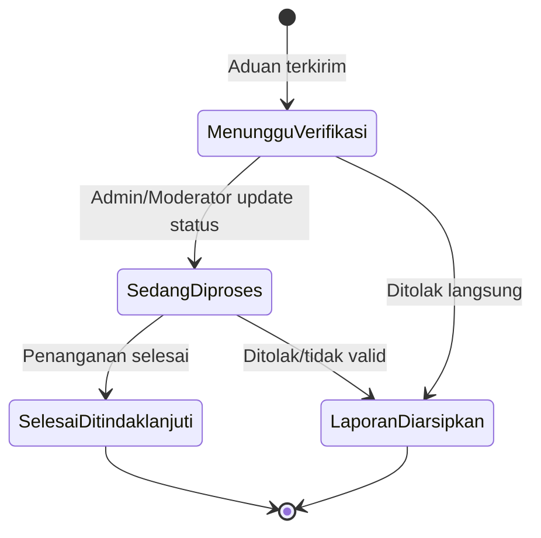
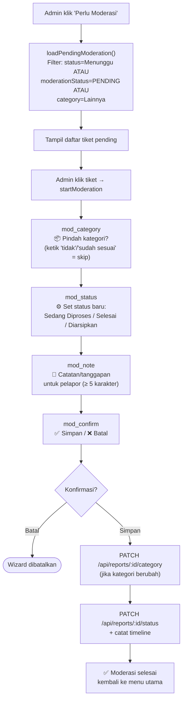
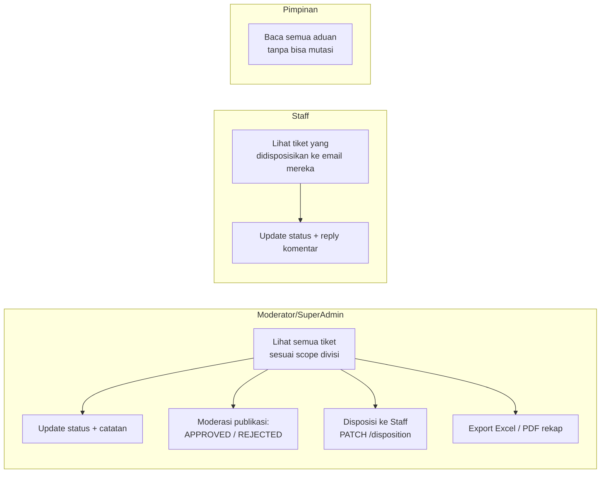

# Dokumentasi alur aduan — Lapor FTI Chatbot

> Versi: Oktober 2026 · Berdasarkan kode sumber aktif

---

## Ringkasan sistem

**Lapor FTI** adalah portal aspirasi dan keluhan resmi Fakultas Teknologi Industri UII. Sistem ini berbasis chatbot yang memandu pelapor melalui wizard percakapan, didukung backend Express + SQLite dengan autentikasi Google OAuth (terbatas domain `@uii.ac.id` dan subdomain).

---

## 1. Autentikasi & akses



**Role yang ada:**

| Role | Hak akses |
|---|---|
| Pelapor (no role) | Submit aduan, lacak aduan milik sendiri |
| `MODERATOR` | Moderasi aduan sesuai divisi |
| `STAFF` | Tindak lanjut tiket yang didisposisikan ke email mereka |
| `PIMPINAN` | Baca semua aduan, tidak bisa mutasi |
| `SUPER_ADMIN` | Akses penuh ke semua aduan dan manajemen admin |

> **Dev shortcut:** `POST /api/auth/dev-login` menggunakan akun dummy `dummy.pelapor@students.uii.ac.id`, hanya aktif saat `NODE_ENV !== production`.

---

## 2. Alur buat aduan (Pelapor)

Seluruh proses dikelola via `ChatContext` → state machine `wizard` tipe `CREATE_REPORT`.



**Kategori yang tersedia:**

| Enum | Label |
|---|---|
| `AKADEMIK` | Akademik & Kurikulum |
| `SARPRAS` | Fasilitas & Sarana Prasarana |
| `PELAYANAN` | Layanan Administrasi & Staf |
| `IT` | Sistem Informasi & IT Portal |
| `KEMAHASISWAAN` | Kemahasiswaan, Minat & Beasiswa |
| `KEUANGAN` | Keuangan & Biaya Kuliah |
| `ETIKA` | Etika, Perundungan & Pelecehan |
| `LAINNYA` | Lainnya |

**Tingkat urgensi:** Rendah · Sedang · Tinggi / Darurat

**Visibilitas:**
- **Publik** → masuk antrian moderasi feed publik (`moderationStatus = PENDING`)
- **Privat** → hanya bisa dilacak via kode tiket oleh pelapor

---

## 3. Status aduan & transisi



Setiap perubahan status **dicatat di `report_timeline`** dengan: status, catatan, timestamp, nama/email aktor.

---

## 4. Alur moderasi via chatbot (Admin)

Admin dengan role `MODERATOR` atau `SUPER_ADMIN` bisa memoderasi aduan langsung dari chatbot menggunakan wizard tipe `MODERATE_REPORT`.



---

## 5. Alur lengkap di Panel Admin (browser)

Selain via chatbot, admin punya **Panel Admin** berfitur lebih lengkap.



**Role-scoping query otomatis:**
- `MODERATOR` → hanya kategori dalam divisinya
- `STAFF` → hanya `disposed_to_email = session.email`
- `SUPER_ADMIN` / `PIMPINAN` → semua aduan

---

## 6. Lacak tiket

Pelapor bisa melacak tiket tanpa membuka menu khusus:

- Ketik **kode tiket** langsung di chat → pattern `/LH-\d{8}-\d{4}/i` terdeteksi otomatis
- Klik **"Aduan Saya"** → filter `reporterEmail = userEmail`

---

## 7. Notifikasi email

| Trigger | Penerima | Isi |
|---|---|---|
| Aduan baru terkirim | Moderator divisi terkait (fallback ke SUPER_ADMIN) | Kode tiket, judul, kategori, urgensi, link portal |
| Disposisi ke Staff | Staff yang ditunjuk | Kode tiket, judul, catatan disposisi, link portal |

Email dikirim **async** (tidak menahan response HTTP) via `sendNotificationEmail`.

---

## 8. Audit log

Setiap aksi admin (update status, disposisi, moderasi publikasi, ubah kategori, impersonasi) dicatat di tabel `audit_log` melalui `logAudit()` dengan: `actorEmail`, `action`, `targetType`, `targetId`, `details`, `timestamp`.

---

## 9. Feed publik

Aduan `isPublic = true` **hanya muncul di feed publik** jika `moderationStatus = 'APPROVED'`. Aduan privat tidak muncul di feed apapun kecuali oleh pemiliknya sendiri atau admin.

---

## 10. Ringkasan API endpoint

| Method | Endpoint | Auth | Fungsi |
|---|---|---|---|
| `GET` | `/api/auth/google/start` | — | Mulai OAuth |
| `GET` | `/api/auth/google/callback` | — | OAuth callback |
| `POST` | `/api/auth/dev-login` | — (dev only) | Login dummy |
| `GET` | `/api/auth/me` | Cookie | Cek sesi |
| `POST` | `/api/auth/logout` | Cookie | Logout |
| `POST` | `/api/auth/impersonate` | SUPER_ADMIN | Login sebagai user lain |
| `POST` | `/api/auth/end-impersonation` | Login | Akhiri impersonasi |
| `GET` | `/api/reports` | Cookie (scoped) | Daftar aduan |
| `POST` | `/api/reports` | Login | Buat aduan baru |
| `GET` | `/api/reports/:id` | — | Detail satu aduan |
| `PATCH` | `/api/reports/:id/status` | Actionable admin | Update status |
| `PATCH` | `/api/reports/:id/disposition` | Moderator+ | Disposisi ke Staff |
| `PATCH` | `/api/reports/:id/moderation` | Moderator+ | Approve/reject feed publik |
| `PATCH` | `/api/reports/:id/category` | Moderator+ | Ubah kategori |
| `POST` | `/api/reports/:id/comments` | Login | Tambah komentar |
| `GET` | `/api/reports/export` | Admin | Export Excel |
| `GET` | `/api/reports/export-pdf` | Admin | Export PDF rekap |
| `GET` | `/api/reports/:id/export-pdf` | Admin | Export PDF satu tiket |
| `POST` | `/api/uploads` | Login | Upload lampiran |

---

## 11. Struktur data tiket

```typescript
interface Report {
  id: string;                  // "LH-YYYYMMDD-XXXX"
  title: string;
  description: string;
  category: ReportCategory;
  status: ReportStatus;        // Menunggu Verifikasi → Sedang Diproses → Selesai / Diarsipkan
  urgency: UrgencyLevel;       // Rendah | Sedang | Tinggi / Darurat
  reporterName: string;        // "Anonim" jika anonim
  reporterRole?: ReporterRole; // Mahasiswa | Dosen FTI | Tendik | Alumni
  reporterEmail: string;
  reporterWhatsapp?: string;
  isPublic: boolean;
  moderationStatus?: "PENDING" | "APPROVED" | "REJECTED";
  createdAt: string;
  updatedAt: string;
  attachmentName?: string;
  attachmentPath?: string;
  disposedToEmail?: string;
  dispositionNote?: string;
  disposedBy?: string;
  disposedAt?: string;
  timeline: { status, note, timestamp, actorName? }[];
  comments: ReportComment[];
}
```
